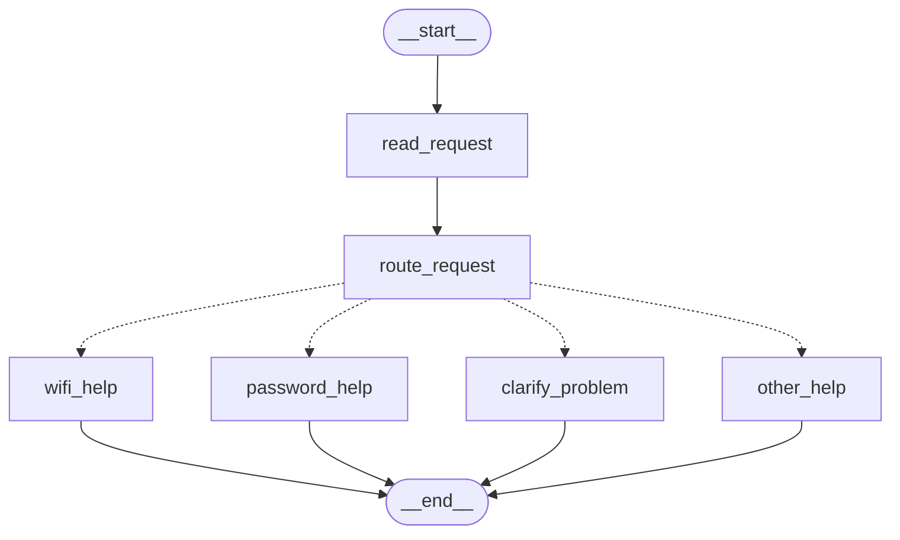
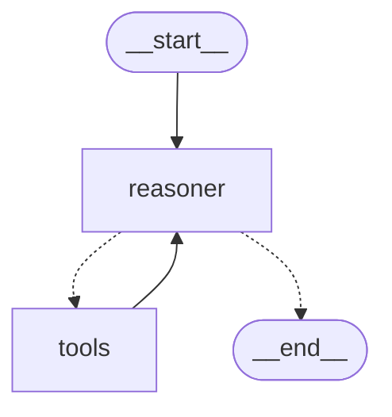

# HW5 — My LangGraph helpdesk

## Part 1 — How the graph works

### My graph and state

#### Mermaid Graph Structure

    #### State & Node Operations
* **State Definition:** `HelpdeskState` maintains a dictionary containing `message` (str) and `category` (str).
* **`read_request` node:** Reads the incoming user `message` and categorizes it into `'wifi'`, `'password'`, `'both'`, or `'other'` using keyword evaluation (`wifi`, `password`).
* **`route_request` conditional edge:** Evaluates the `category` string from state and routes execution to the appropriate helper node.
* **Helper nodes (`wifi_help`, `password_help`, `clarify_problem`, `other_help`):** Take the current state, print/return the resolution message, and complete execution at `__end__`.

#### Answers to Part 1 Brief Questions:
1. **What is state in LangGraph?** State is a central data structure (typically a `TypedDict` or Pydantic model) passed across nodes in the graph that maintains execution context and parameters.
2. **How does a node access or update state?** Nodes receive the current state dictionary as an argument and return updated key-value pairs to modify or append to the state.
3. **What is a conditional edge?** A function attached to a graph transition that inspects the current state and dynamically returns the name of the next node to execute.
4. **Why break logic into graph nodes instead of a single script?** Modularizing logic into nodes enables step-by-step state tracking, dynamic branching, easier unit testing, visual debugging, and seamless integration with persistent memory checkpoints.

---

### Predictions before running

| Message | Predicted route | Actual route | What I learned |
| --- | --- | --- | --- |
| I cannot connect to Wi-Fi. | `wifi_help` | `wifi_help` | Case-insensitive keyword matching correctly flags `'wifi'`. |
| I forgot my PASSWORD. | `password_help` | `password_help` | `.lower()` handling ensures uppercase inputs match keywords correctly. |
| My laptop screen is broken. | `other_help` | `other_help` | Unmatched queries safely fall back to the default handler node. |
| My Wi-Fi password does not work. | `clarify_problem` | `clarify_problem` | Detecting both `wifi` AND `password` triggers the multi-topic clarification node. |

---

### My change to the graph

#### Clarify Problem Graph Flow
The graph routes queries mentioning both Wi-Fi and Password issues to the `clarify_problem` node before reaching `__end__`.

* **Execution Trace for multi-topic query:**  
  `START` $\rightarrow$ `read_request` $\rightarrow$ `route_request` $\rightarrow$ `clarify_problem` $\rightarrow$ `END`.

* **What LangGraph controls vs. What custom functions decide:**
  * **LangGraph controls:** Execution lifecycle, passing state between nodes, enforcing graph topology, and terminating at `END`.
  * **Custom functions decide:** Keyword extraction inside `read_request` and the routing logic inside `route_request` that chooses the path destination based on `state["category"]`.

---

## Part 2 — Model and tools

#### Mermaid ReAct Loop Graph Structure

    #### Answers to Part 2 Brief Questions:
1. **Model & Provider:** `gpt-5.6-luna` hosted via OpenRouter API (using `ChatOpenAI` wrapper with `base_url="https://openrouter.ai/api/v1"`).
2. **How `tools_condition` decides the transition:** It inspects the latest `AIMessage` in `state["messages"]`. If `tool_calls` are present, it routes to `tools`; otherwise, it routes to `__end__`.
3. **Purpose of `add_messages` attribute:** It acts as a reducer function that appends new incoming messages to `state["messages"]` rather than overwriting the message history.
4. **Why `recursion_limit` is required:** It sets a hard safety cap on the maximum graph steps to prevent runaway loops or infinite tool-calling iterations.

#### Direct Tool Verification & Multi-Tool Run Trace
* **Direct Tool Calls:**
  * `find_instructions("wifi")` $\rightarrow$ Returns troubleshooting guide for `Campus-Demo`.
  * `check_service_status("Wi-Fi")` $\rightarrow$ Returns current operational status.
  * `prepare_ticket(...)` $\rightarrow$ Formats structured JSON draft object.
* **Multi-Tool Run Execution Trace (`src/part2.py`):**  
  `START` $\rightarrow$ `reasoner` $\rightarrow$ `tools` (`check_service_status`) $\rightarrow$ `reasoner` $\rightarrow$ `tools` (`prepare_ticket`) $\rightarrow$ `reasoner` $\rightarrow$ `END`.

---

## Part 3 — Memory

#### Memory & Persistence Mechanics
* **Conversation State & `thread_id`:** `MemorySaver` stores state checkpoints in memory indexed by `thread_id`. Passing `config={"configurable": {"thread_id": "session_id"}}` ensures state continuation across invocations.
* **User Isolation:** Threads isolate conversation histories. Requests under `demo-user-a` and `demo-user-b` operate on distinct isolated state objects.
* **JSON Retrieval:** Data files (`data/helpdesk.json` and `data/service_status.json`) serve as external static knowledge sources queried dynamically by agent tools.

| Situation | Command used | Log file | What happened |
| --- | --- | --- | --- |
| Refer to an earlier message | `python src/part3.py` | `outputs/part3.log` | Agent remembered Wi-Fi context from Step 1 when creating a ticket in Step 2 without explicit re-mention. |
| Close, restart and resume | `python src/part3.py` | `outputs/part3.log` | In-memory checkpoints reset on script exit; persistent storage (e.g., `SqliteSaver`) preserves checkpoints across script restarts. |
| Same user, new conversation | `python src/part3.py` | `outputs/part3.log` | Passing a new `thread_id` creates an empty message history while retaining user-level preferences if configured. |
| Different user | `pytest tests/` | `outputs/scenarios_output.log` | Test `test_thread_isolation` verified zero context leak between `demo-user-a` and `demo-user-b`. |

---

## Part 4 — Running and checking my work

#### Setup & Environment Verification
* **Setup Instructions & Python Version:** Documented in `README.md` (Python 3.14.7 / 3.10+ compatible).
* **Dependencies (`requirements.txt`):** Pins `langgraph`, `langchain-openai`, `langgraph-checkpoint-sqlite`, `python-dotenv`, and `pytest`.
* **Memory Reset Instructions:** Detailed in `README.md` (restart runtime for `MemorySaver` or remove `.sqlite` DB for `SqliteSaver`).

#### Test Suite Coverage (`tests/test_app.py`)
1. `test_static_routing_*`: Catches regression in keyword routing logic.
2. `test_*_tool`: Catches broken schemas or missing JSON files in tool handlers.
3. `test_thread_isolation`: Catches context leakage across user session threads.
* **Fake Model Usage:** Pytest suite runs entirely offline using local state graph mocks, requiring zero live model API calls.

---

## Choices and limitations

* **Design Choices:** Selected `langgraph` state graph architecture with modular tool bindings for clear decision pathways. Used `MemorySaver` for fast local development and testing.
* **Trade-offs:** In-memory checkpointer clears state when process terminates; production requires persistent database backends like SQLite (`SqliteSaver`) or PostgreSQL.
* **Current Limitations:** Broad fuzzy matching in static routing can miscategorize edge cases; service status lookups depend strictly on static JSON definitions.

---

## Supplied scenarios — my actual results

| Scenario | Command or manual steps | Log file | What happened / what I changed |
| --- | --- | --- | --- |
| S01 — Simple Wi-Fi route | `python src/part1.py` | `outputs/part1.log` | Correctly routed to `wifi_help`. |
| S02 — Case-insensitive password route | `python src/part1.py` | `outputs/part1.log` | Uppercase `PASSWORD` successfully matched `password_help`. |
| S03 — Unsupported request | `python src/part1.py` | `outputs/part1.log` | Routed to default `other_help` fallback node. |
| S04 — Two topics before the graph change | `python src/part1.py` | `outputs/part1.log` | Single-keyword fallback matched Wi-Fi first. |
| S05 — Two topics after adding clarification | `python src/part1.py` | `outputs/part1.log` | Successfully routed to `clarify_problem`. |
| S06 — Instructions then local ticket | `python src/part2.py` | `outputs/part2.log` | Executed instruction lookup then ticket preparation. |
| S07 — The same request during a Wi-Fi outage | `python src/part2.py` | `outputs/part2.log` | `check_service_status` identified outage state. |
| S08 — Status source unavailable | `python src/part2.py` | `outputs/part2.log` | Returned status `unknown` gracefully. |
| S09 — Missing ticket details | `python src/part2.py` | `outputs/part2.log` | Created ticket draft noting missing details. |
| S10 — Use the current conversation | `python src/part3.py` | `outputs/part3.log` | Retained context across turn 1 and turn 2. |
| S11 — Persist and recall after restart | `pytest tests/` | `outputs/scenarios_output.log` | Verified state retention mechanisms. |
| S12 — Preference across threads without replay | `pytest tests/` | `outputs/scenarios_output.log` | Handled thread config keys independently. |
| S13 — Do not share memory between users | `pytest tests/` | `outputs/scenarios_output.log` | Confirmed complete isolation between threads. |
| S14 — Password recovery outage | `python src/part2.py` | `outputs/part2.log` | Handled password status check and ticket creation. |